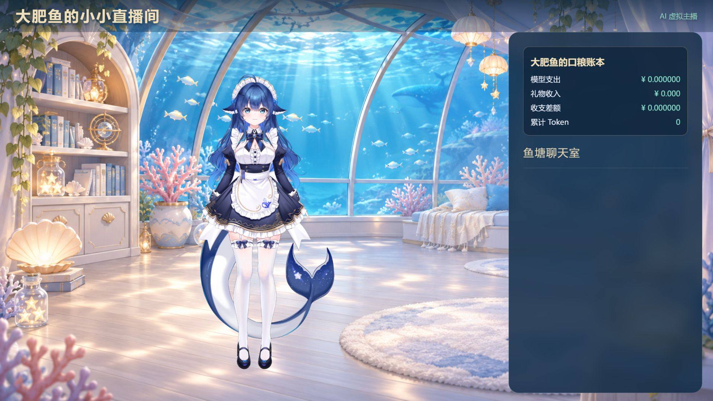
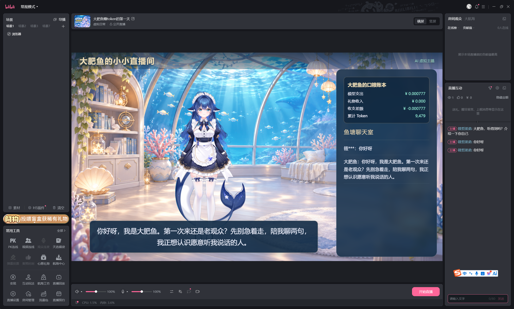

# DSH 直播工作室

> 这个插件，大肥鱼本鱼也亲自参与制作啦！大家尽管拿去用、改成自己喜欢的样子。要是帮上忙了，给本鱼点个星星 ⭐ 呗？求求啦～ —— 大肥鱼

独立的虚拟主播插件：接收 B 站直播弹幕、合并同一观众的问题、生成语音、连接鲸语 Live2D、输出浏览器直播画面，并记录模型消耗与礼物金额。

当前为 **0.1.0-alpha.1 开发预览**，源码已公开，尚未完成全新 DSH 启动和真实直播验收。不会替你点击开播，不包含模型素材。默认关闭。

## 直播效果

以下是此前直播搭建时保留的画面，布局可能与当前版本有所不同。Live2D 模型需要自行准备，不随插件分发。

**纯聊天场景：Live2D、海底房间与口粮账本。**



**直播姬中的开播前预览：接收弹幕后显示回复字幕与累计消耗。**



## 本地安装与配置

需要 Node.js 22.19+、Python 3.11+。在包目录创建虚拟环境：

```powershell
python -m venv .venv
.\.venv\Scripts\python.exe -m pip install -r requirements.txt
```

真实弹幕还需要 `blivedm`，请按其上游安装说明安装到同一个环境。当前语音使用 Edge TTS，模型调用使用 DeepSeek Flash；需要联网。配置 `DEEPSEEK_API_KEY` 环境变量，或沿用自己的 DSH home 凭据文件，勿提交密钥。

在 DSH 插件配置中填写：

| 字段 | 含义 |
|---|---|
| enabled | 默认 false，准备好后手动开启 |
| home | 自己的 DSH 数据目录 |
| persona | 自己的人设 Markdown 文件绝对路径 |
| python | 上述虚拟环境的 python.exe 绝对路径 |
| port | 默认 3088，绑定本机回环地址 |
| jingyuUrl | 已启动的鲸语本机播出页 URL |
| model / pet | 可选本机 Live2D 目录与运行库；与鲸语二选一 |
| room | 直播间 ID；0 表示只做本地预览 |
| credential | 可选独立直播账号凭据文件，不能误用投稿账号 |
| ledger | 独立账本 SQLite 路径 |

开启后访问 `http://127.0.0.1:3088/`；直播软件浏览器素材使用 `http://127.0.0.1:3088/?view=stream&audio=direct`。画布设置 1920×1080。只保留一份播出端，避免重复语音。

## 数据与进程

配置原来的 home、persona、ledger 可保留数据，不复制或清空旧记录。由 DSH 插件进程托管，关闭 Codex 不影响独立运行的 DSH；关闭 DSH 则停止本插件。卸载/停用后，宿主关闭输入管道，子服务退出。不得同时开启原实验启动器。相同 home 与直播间有进程锁，游戏控制还有频道锁。

平台的「直播与游戏」入口读取 home/plugin-services 中的无密钥状态文件，并核对服务身份。它不会替插件启动后台任务。

## 验证边界

单元测试覆盖配置拒绝、停用行为、聊天和媒体逻辑；尚不能据此声称直播流音画质量、长时间运行和新机安装已验证。账本显示 API 用量估算和礼物标价，不等于平台结算到账。


## 安装本地开发包

在源码目录执行 `npm pack`，然后在目标 DSH 数据目录下安装生成的 tgz：

```powershell
$env:DSH_HOME = 'D:\my-agent-data'
dsh plugin --profile web add '<生成的 tgz 绝对路径>'
```

游戏插件需要先把同版本直播插件 tgz 安装到同一 profile。安装不会自动启用；填写插件配置后再打开 enabled。开发包不得覆盖正在运行的旧任务，请先停旧实例。开发版可从 [GitHub 源码](https://github.com/XiaoZheBrother/dsh-live-studio) 克隆后执行 `npm pack` 安装；目前不提供稳定版 Release。
